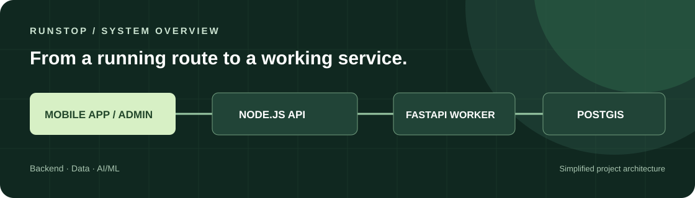

# 문제를 구조로 이해하고, 코드로 검증합니다.

안녕하세요. 개발자 **허완**입니다. 백엔드와 데이터 기반 서비스를 구현하며, 설계한 시스템이 실제로 어떻게 동작하는지 확인하는 과정을 중요하게 생각합니다.

**Backend · AI/ML · Engineering**

[프로젝트 보기](#selected-work) · [포트폴리오](https://app.notion.com/p/1be117a41d4d80feae10fe11f2262b54) · [기술 블로그](https://hurwan.tistory.com)

---

## Selected work

### RunStop · 러닝 코스 추천 서비스

**2026.08.23 – 2026.09.20 · 팀 프로젝트**

거리, 경사, 주변 시설과 시간 정보를 고려해 러닝 코스를 제안하는 서비스입니다. 모바일 앱, Node.js API, FastAPI Worker와 PostgreSQL/PostGIS를 연결했습니다.

참여자 기록에 따르면 **서비스 아키텍처·DB·서버 설계, 프로젝트 문서화, AI 추천 모델** 작업에 참여했습니다.

`Node.js` `FastAPI` `PostgreSQL / PostGIS` `Docker`

[코드와 README](https://github.com/hurwan0629/RunStop) · [설계 및 개발 기록](https://app.notion.com/p/93c4bef3cd8549f3b84e0801bbb43b8b)

### Space Z · 강화학습 실험

Python/Pygame 게임을 강화학습 환경과 연결하고 PPO 학습을 실험한 팀 프로젝트입니다. 실험 과정과 시각화 기록을 저장소에서 확인할 수 있습니다.

`Python` `Pygame` `PyTorch` `Gymnasium` `Stable-Baselines3`

[코드와 README](https://github.com/hurwan0629/kdt-final-3-space-z) · [강화학습 환경 문서](https://github.com/hurwan0629/kdt-final-3-space-z/blob/main/src/space_z/rl/README.md)

### Ornably · 쇼핑몰 웹 서비스

**2025.11.19 – 2026.01.08 · 4명 팀 프로젝트**

로그인, 상품, 주문, 결제 흐름을 구현하며 웹 서비스의 구조를 학습한 프로젝트입니다. 저장소의 구현은 Java Servlet/JSP, JDBC, Oracle 기반입니다.

`Java` `Servlet / JSP` `JDBC` `Oracle`

[코드와 README](https://github.com/hurwan0629/BugSandwichOrnamentMall) · [프로젝트 문서](https://app.notion.com/p/2e3117a41d4d8048b1a6dda54bb58bc1)

---

## 개발 접근 방식

1. 요구사항과 데이터 흐름을 먼저 정리합니다.
2. 구현한 기능을 실제 사용 흐름에서 확인합니다.
3. 실험 과정과 설계 판단을 문서로 남깁니다.

## 사용한 기술

| 영역 | 프로젝트에서 사용한 기술 |
| --- | --- |
| Backend | Java, Servlet/JSP, Node.js, FastAPI |
| Data & AI | PostgreSQL/PostGIS, Oracle, Python, PyTorch, Gymnasium |
| Tools | Docker, GitHub |

---

**기록과 코드 더 보기**

[포트폴리오](https://app.notion.com/p/1be117a41d4d80feae10fe11f2262b54) · [기술 블로그](https://hurwan.tistory.com) · [GitHub](https://github.com/hurwan0629)

